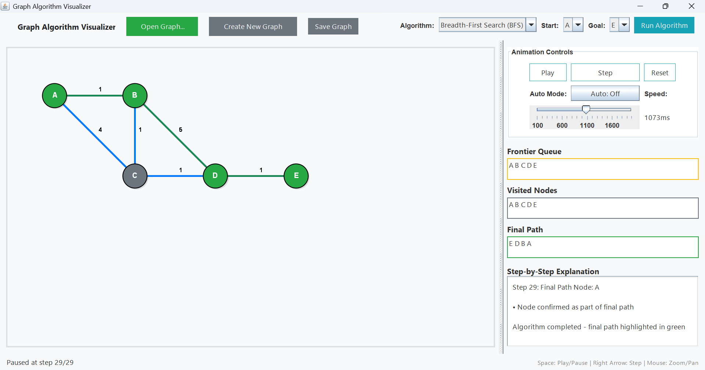

# Dynamic Route Finder

A robust Java-based application and visualizer for exploring and comparing classic graph traversal and pathfinding algorithms. This tool features an interactive Swing-based graphical user interface (GUI) to visualize step-by-step path recalculation, edge manipulation, and real-time algorithmic execution.

---
## Application Preview



Interactive Graph Algorithm Visualizer showing BFS execution,
frontier queue, visited nodes, and the final path.
---
## Features

* **Interactive Graph Visualization:** Built with Java Swing to let users visualize nodes, edges, weights, and algorithm execution paths in real-time.


* **Algorithm Implementation & Tracing:** Supports multiple pathfinding and graph traversal strategies, providing step-by-step trace results and animation steps.


* **Dynamic Path Recalculation:** Handles graph modifications dynamically and recalculates optimal paths efficiently.
* **Modular Architecture:** Clean separation of concerns with dedicated components for graph serialization, canvas rendering, node/edge management, and algorithm execution.

---

## Tech Stack

* **Language:** Java


* **UI Framework:** Java Swing, JavaFX (integrated libraries)


* **Build/Structure:** Standard Java project structure with compiled class binaries (`bin/`) and external dependencies (`lib/`)


---

## Project Structure

```text
Dynamic-Route-Finder-main/
│
├── bin/                      # Compiled class files (.class)
│   ├── AnimationStep.class
│   ├── Edge.class
│   ├── Graph.class
│   ├── GraphVisualizerSwing.class
│   ├── Main.class
│   └── Node.class
│
├── lib/                      # External libraries and JavaFX dependencies
│   ├── javafx.base.jar
│   ├── javafx.controls.jar
│   └── javafx-swt.jar
│
└── README.md                 # Project documentation

```

---

## Getting Started

### Prerequisites

* Ensure you have **Java Development Kit (JDK)** installed (JDK 8 or higher recommended).
* Make sure JavaFX runtime dependencies are configured correctly if running outside of the bundled IDE/lib configuration.

### Installation & Running

1. **Clone or Download** the repository to your local machine.
2. Open your terminal or command prompt and navigate to the project root directory.
3. Compile the source files (if running from raw source) or execute the main class directly from the `bin` directory:

```bash
java -cp bin:lib/* Main

```

*(Note: Adjust classpath separators depending on your operating system—use `;` for Windows and `:` for macOS/Linux).*

---

## Usage

1. Launch the application to open the **Graph Visualizer Dashboard** from running **Main.java**.
2. Create or load a graph structure containing nodes and weighted edges.
3. Select your desired pathfinding algorithm and start the simulation to view step-by-step traversal animations.

---

## License

This project is open-source and available under the standard repository terms.
--in this file, i want to add this screenshot 
--how do i add that?
